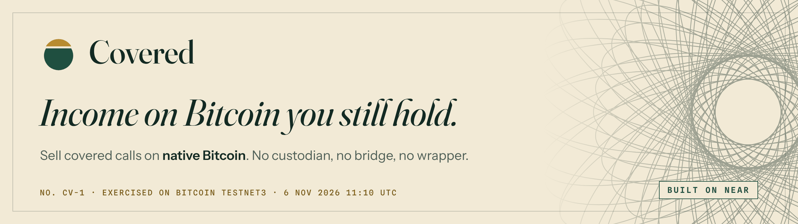
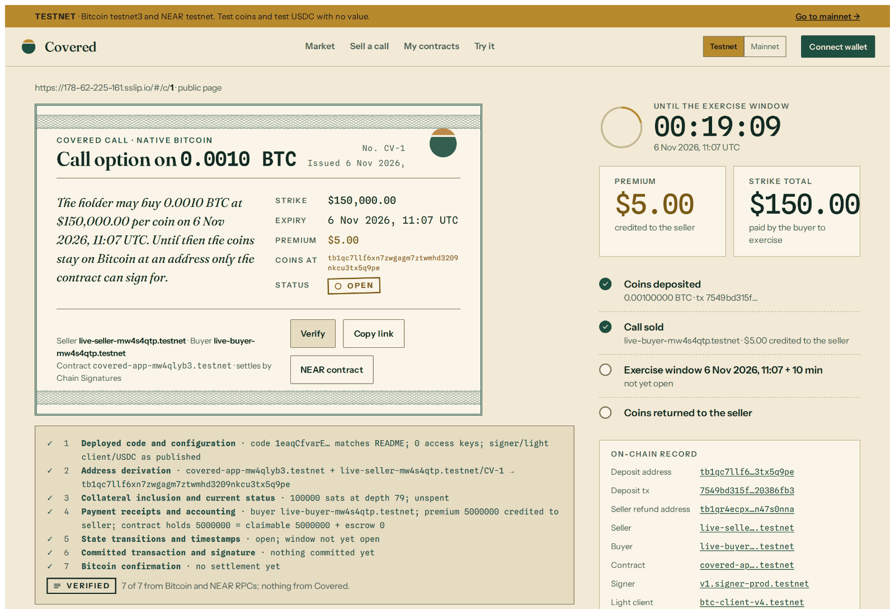
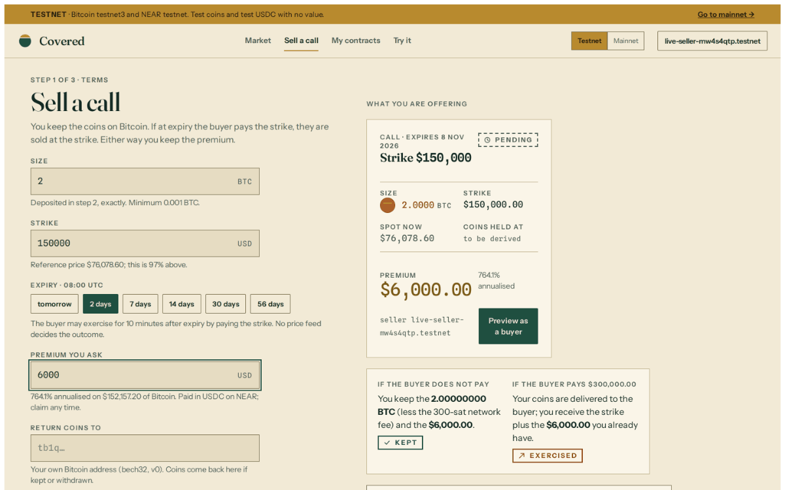
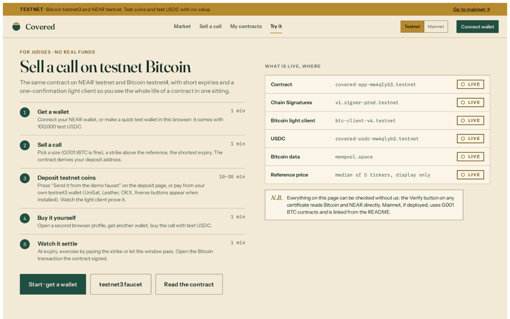

<p align="center">
  <picture>
    <source media="(prefers-color-scheme: dark)" srcset="docs/readme/banner-vault.png">
    
  </picture>
</p>

<p align="center">
  <a href="https://github.com/bedeho/covered/actions/workflows/ci.yml"></a>
  <a href="https://github.com/bedeho/covered/actions/workflows/stack.yml"></a>
  <a href="https://github.com/bedeho/covered/actions/workflows/live.yml"></a>
  <a href="https://178-62-225-161.sslip.io"></a>
  <a href="docs/SECURITY-MODEL.md"></a>
  <a href="SECURITY.md"></a>
  
</p>

<p align="center">
  <b><a href="https://178-62-225-161.sslip.io/#/try">Try it on testnet</a></b> ·
  <a href="#how-it-works">How it works</a> ·
  <a href="#run-it-yourself">Run it yourself</a> ·
  <a href="#security">Security</a> ·
  <a href="SECURITY.md">Bug bounty</a>
</p>

---

You have held Bitcoin for years and it has earned nothing. The usual way to make it earn is to hand it to an exchange or a lender and hope. **Covered pays you today for agreeing to sell your coins at a higher price later, and the coins never leave Bitcoin.**

- **Your coins stay on Bitcoin.** They sit at an address that only a NEAR contract can sign for, through NEAR's MPC signing network. No exchange, no bridge, no wrapped token, and no key that we hold.
- **You are paid up front.** The buyer pays the premium in USDC the moment they buy. It is yours whatever happens next.
- **Every step is checkable.** Each contract is a public certificate with a **Verify** button: seven checks run in your browser against Bitcoin and NEAR, with nothing from our servers.

<p align="center">
  <picture>
    <source media="(prefers-color-scheme: dark)" srcset="docs/readme/shot-certificate-vault.png">
    
  </picture>
  <br>
  <sub>Certificate CV-1 on the live testnet site, Verify 7 of 7. Captured 6 Nov 2026, 10:47 UTC.</sub>
</p>

## How it works

1. **Lock.** You choose a size, a strike and an expiry. The contract derives a fresh Bitcoin address that only it can sign for, and you send your coins there. NEAR's Bitcoin light client proves the deposit on chain.
2. **Earn.** A buyer pays your premium in USDC. It is credited to you in the same transaction that records the sale.
3. **Settle.** At expiry the buyer may pay the strike during a short exercise window. If they do, the contract signs your coins over to them and you receive the strike. If they don't, anyone can settle, and the contract signs the coins back to you.

No price feed decides the outcome. The only way to get the coins is to pay for them.

**An example.** You sell a call on 2 BTC with a $150,000 strike, expiring 31 Dec 2026 08:00 UTC, for a $6,000 premium.

| At expiry | You end with |
|---|---|
| The buyer does not pay the strike: **KEPT** | your 2 BTC back, plus the $6,000 |
| The buyer pays the strike: **EXERCISED** | $300,000 for the coins, plus the $6,000 |

## Proven on real Bitcoin

On 6 Nov 2026 one full contract ran on Bitcoin testnet3 and NEAR testnet, through the deployed contract, the real MPC signer and the real light client ([run](https://github.com/bedeho/covered/actions/runs/42196248720)):

| UTC | What happened |
|---|---|
| 09:36:21 | CV-1 created: 0.001 BTC, strike $150,000, premium $5 |
| 09:36:22 | Deposit sent: [`7549bd31…86fb3`](https://mempool.space/testnet/tx/7549bd315f9fd8e638b1f54aa43b7cb28f8a68e598f35852a3b8814f20386fb3) |
| 09:38:23 | **Funded**: the light client `btc-client-v4.testnet` accepted the proof |
| 09:38:27 | Sold for 5 USDC |
| 11:07:16 | Exercised: the buyer paid the 150 USDC strike |
| 11:07:46 | Signed by `v1.signer-prod.testnet` and broadcast: [`9fada3e1…85d75`](https://mempool.space/testnet/tx/9fada3e1f5617863d65084470a200d23622447236350c16da4c6d809b5b85d75) |
| 11:10:54 | **Exercised**: spend proven on NEAR, seller claimed 155 USDC |

Contract: [`covered-app-mw4qlyb3.testnet`](https://testnet.nearblocks.io/address/covered-app-mw4qlyb3.testnet), no access keys, code hash `1eaqCfvarE7A88k6m4toGJdbUYydF2mhdwftoQuyXeJ`.

## See it

<table>
  <tr>
    <td width="50%"></td>
    <td width="50%"></td>
  </tr>
  <tr>
    <td><sub><b>Sell a call.</b> Set the terms and see both endings before you commit.</sub></td>
    <td><sub><b>Try it.</b> The whole life of a contract on testnet, in one sitting.</sub></td>
  </tr>
</table>

## Try it in five minutes

The [testnet site](https://178-62-225-161.sslip.io/#/try) uses test coins and test USDC with no value.

1. **Get a wallet.** Connect a NEAR wallet, or take a quick test wallet with 100,000 test USDC.
2. **Sell a call.** 0.001 tBTC, a strike above the reference price, the shortest expiry.
3. **Deposit.** Press *Send it from the demo faucet*, or pay from your own testnet3 wallet. Watch the light client prove it.
4. **Buy it yourself** from a second browser profile.
5. **Watch it settle.** Exercise by paying the strike, or let the window pass. Then press **Verify**.

## Run it yourself

To run the app you need **Docker 24+ with Compose v2**, an internet connection for the first build, and ports **80**, **3030** and **18443** free. Nothing else is installed on your machine and no accounts or keys are needed.

```sh
git clone https://github.com/bedeho/covered && cd covered
bin/covered up
```

The first run takes 4 to 8 minutes, mostly compiling the contracts inside Docker; later runs take seconds. It ends with `Covered is at http://localhost`. Open **http://localhost**.

**What runs locally.** Everything is on your machine: a NEAR sandbox node, a Bitcoin Core regtest node, the `covered` contract, the relayer and the web app, plus two demo users with 1,000,000 test USDC each. Three pieces are local stand-ins for live NEAR services, with the same interfaces: a **mock MPC signer** (same key derivation as `v1.signer`), a **mock Bitcoin light client**, and a **mock USDC** token. The spot price is fixed at $97,420. The real signer and light client are exercised on testnet (see [Proven on real Bitcoin](#proven-on-real-bitcoin) and [DEVELOPING.md](docs/DEVELOPING.md#tests)).

**Check that it works.** With the stack up, run the end-to-end test (needs **Node 22** on your machine; it installs its own Chromium):

```sh
bin/covered e2e-stack
```

In about two minutes it drives two contracts through their whole life, one **KEPT** and one **EXERCISED**: create, deposit on regtest, proof, sale, settlement and claim. It then sells and deposits once through the web app, presses **Verify** in a real browser (7 of 7 on each certificate), and sweeps a deposit with the seller's rescue kit after its timelock. The last line is `E2E PASSED`, and screenshots land in `e2e/artifacts/`. On a fresh Linux machine, run `cd e2e && npx playwright install --with-deps chromium` once first, so the browser's system libraries are present.

The same two commands run on a clean machine in CI on every pull request and every push to `main` ([stack workflow](https://github.com/bedeho/covered/actions/workflows/stack.yml)), on both x86-64 and arm64.

**Useful commands**

```sh
bin/covered keys                  # the demo users, astrid and marcus, and their keys
bin/covered btc send <addr> 0.01  # pay a deposit address on regtest and mine a block
bin/covered logs relayer          # watch proofs, settlement and broadcasts
bin/covered reset                 # wipe chain state and start over
bin/covered rescue <kit> <addr>   # the seller's exit: sweep a deposit with only Bitcoin, after its timelock
```

**Tests**

These run on your machine rather than in Docker:

```sh
bin/covered test        # unit tests: contract, relayer, web. Needs Rust 1.85+ and Node 22
bin/covered e2e         # contract flows on a NEAR sandbox node. Also needs the wasm32 target and cargo-near 0.23 (see DEVELOPING.md)
bin/covered e2e-stack   # the whole product against a running `bin/covered up`, as above
```

**Deploy** to one DigitalOcean VM with a real certificate, no domain needed: `gh workflow run cloud.yml -f action=apply`. On testnet the VM deploys and locks its own contract on first start.

More: [local stack and tests](docs/DEVELOPING.md) · [deployment](docs/DEPLOY.md) · [configuration](docs/DEVELOPING.md#configuration)

## Security

Covered is **unaudited** software. Testnet is live; mainnet is not. Read the contract before you trust it.

| You trust | You don't trust |
|---|---|
| NEAR's MPC signing network signs only for the contract that asks, and a threshold of its nodes is honest | **Us.** We cannot move coins. The relayer and the site only relay proofs, pay gas and broadcast transactions the contract already signed. Every contract method is public. |
| The Bitcoin light client follows the real chain | **A price feed.** Nobody's price decides who gets the coins. |
| The contract code, which has no access keys and no upgrade method; mainnet offers are capped at 0.01 BTC while it is unaudited | **The buyer.** Coins go to the buyer only in the receipt where the full strike is paid. |

If NEAR or its signing network ever stopped, you would not be stuck: every deposit address has a timelocked exit to a rescue key that only you hold, which you sweep with nothing but Bitcoin (`bin/covered rescue`).

- [Security model](docs/SECURITY-MODEL.md): guarantees, what is not guaranteed, mainnet readiness, the seven Verify checks, the invariants to read first.
- **Found a problem?** Report it privately through [GitHub security advisories](https://github.com/bedeho/covered/security/advisories/new). Bounties up to **$2,000**, paid in USDC or BTC. See [SECURITY.md](SECURITY.md).

## Built with

[NEAR Chain Signatures](https://docs.near.org/chain-abstraction/chain-signatures) (`v1.signer`) to sign Bitcoin transactions from a contract · NEAR's Bitcoin light client to prove deposits and spends · NEP-366 meta-transactions, so users need no NEAR for gas · USDC on NEAR for premiums and strikes. Rust (`near-sdk`, `rust-bitcoin`) for the contract, TypeScript for the relayer and the app.

## Documentation

| Read | For |
|---|---|
| [SPEC.md](docs/SPEC.md) | The full product and technical specification |
| [SECURITY-MODEL.md](docs/SECURITY-MODEL.md) | What you trust, what is guaranteed, mainnet readiness, pinned external interfaces |
| [DEVELOPING.md](docs/DEVELOPING.md) | Local stack, the life of a contract, tests, CI, configuration, layout |
| [DEPLOY.md](docs/DEPLOY.md) | The cloud deployment, networks, wallets, faucet, domains |
| [SECURITY.md](SECURITY.md) | How to report a vulnerability, and the bounty |
| [brand/](brand/BRAND.md) | The design system: tokens, components, logos, fonts |

## License

[MIT](LICENSE). The bundled fonts (Fraunces, Instrument Sans, Spline Sans Mono, in `brand/fonts/` and `web/public/ds/fonts/`) are third-party works under the [SIL Open Font License 1.1](https://openfontlicense.org).

<p align="center"><sub>Covered is unaudited. It is not a price guarantee, not investment advice, and not an offer of options to the public. Signatures come from NEAR's MPC network; if that network stops, settlement waits for it or for the seller's timelocked exit.</sub></p>
